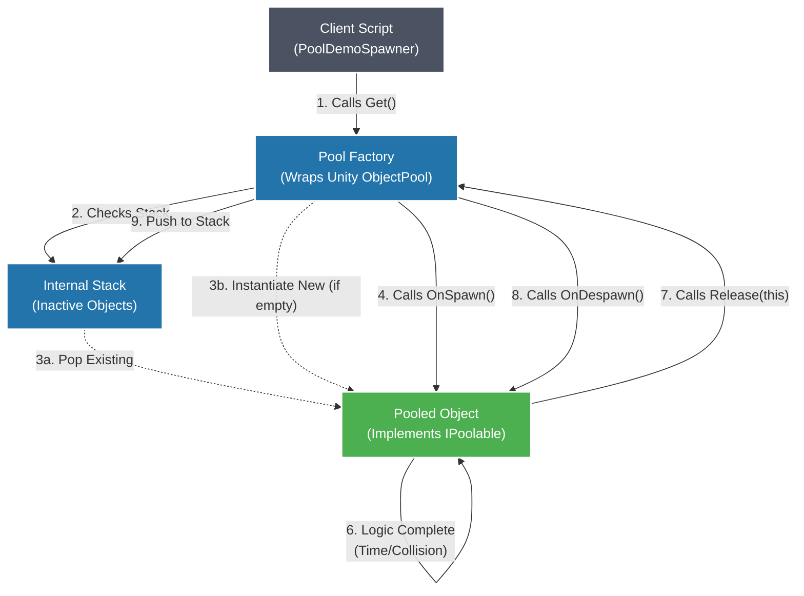

Here is the **fully GitHub-ready README**.
You can **copy paste this directly into `README.md`** and it will render correctly on GitHub.
I removed unsupported attributes and ensured **Markdown + Mermaid + tables render properly**.

---

# ♻️ Advanced Object Pooling System (Unity 2021+)


A **generic, interface-driven object pooling system** for Unity built on top of the modern `UnityEngine.Pool` API.

This module provides a **memory-safe, zero-allocation solution** for spawning high-frequency objects such as:

* Bullets
* Particles
* Enemies
* VFX
* Temporary gameplay objects

It removes the need for slow `List<GameObject>` searches or monolithic pooling managers.

---

# 🚀 Overview

Traditional Unity pooling systems often rely on:

* `List<GameObject>` scanning
* Singleton managers
* Manual lifecycle management

This architecture introduces a **Generic Factory (`ComponentPoolFactory<T>`)** that wraps Unity’s native **stack-based `ObjectPool<T>`**.

Objects implement the `IPoolable<T>` interface and manage their own lifecycle using:

* `OnSpawn()`
* `OnDespawn()`

Each object is injected with its pool reference, allowing it to **return itself automatically**, keeping the system **fully decoupled** from the spawner.

---

# 🧠 Key Features

### Generic & Type Safe

Works with any `MonoBehaviour` implementing:

```csharp
IPoolable<T>
```

---

### Self-Managing Objects

Pooled objects receive their pool reference and can **release themselves** when finished.

Example triggers:

* Timer
* Collision
* Animation completion

---

### Zero Allocation Runtime

Uses Unity’s **stack-based `ObjectPool<T>`**, ensuring:

```
0 B GC allocations when spawning/despawning
```

Perfect for **high-frequency gameplay loops**.

---

### Safety Checks

Optional **editor-only collection checks** prevent common bugs such as:

* Releasing an object already in the pool
* Double releasing the same object

---

# 🏗️ Lifecycle



---

# 📂 Project Structure

This project uses **Assembly Definitions (`.asmdef`)** to enforce clean architecture boundaries.

```
Assets/AdvancedPooling/

Core/
 ├── AdvancedPooling.Core.asmdef
 └── IPoolable.cs

Runtime/
 ├── AdvancedPooling.Runtime.asmdef
 └── ComponentPoolFactory.cs

Unity/
 ├── AdvancedPooling.Unity.asmdef
 └── PoolDemoSpawner.cs
```

### Layer Responsibilities

| Layer       | Purpose                                |
| ----------- | -------------------------------------- |
| **Core**    | Contains pure interfaces and contracts |
| **Runtime** | Contains the pooling implementation    |
| **Unity**   | Example MonoBehaviour usage            |

This separation improves:

* Modularity
* Testability
* Clean dependency flow

---

# 🛠️ Usage

## 1️⃣ Implement `IPoolable<T>`

Example `Bullet` implementation:

```csharp
using UnityEngine;
using UnityEngine.Pool;
using AdvancedPooling.Core;

public class Bullet : MonoBehaviour, IPoolable<Bullet>
{
    private IObjectPool<Bullet> _pool;

    // Dependency Injection from factory
    public void Initialize(IObjectPool<Bullet> pool)
    {
        _pool = pool;
    }

    // Called when object is retrieved from the pool
    public void OnSpawn()
    {
        Invoke(nameof(ReturnToPool), 2f);
    }

    // Called when object is returned to the pool
    public void OnDespawn()
    {
        CancelInvoke();
    }

    private void ReturnToPool()
    {
        _pool.Release(this);
    }
}
```

---

## 2️⃣ Create the Pool

Initialize the factory inside your controller.

```csharp
using UnityEngine;
using AdvancedPooling.Runtime;

public class WeaponController : MonoBehaviour
{
    [SerializeField] private Bullet _prefab;

    private ComponentPoolFactory<Bullet> _bulletPool;

    void Start()
    {
        _bulletPool = new ComponentPoolFactory<Bullet>(
            prefab: _prefab,
            defaultCapacity: 20,
            maxSize: 100
        );
    }

    void Fire()
    {
        Bullet bullet = _bulletPool.Get();

        bullet.transform.position = transform.position;
        bullet.transform.rotation = transform.rotation;
    }
}
```

---

# ⚙️ Architecture Principles

This system follows several **software engineering best practices**:

| Principle               | Implementation                                  |
| ----------------------- | ----------------------------------------------- |
| Dependency Injection    | Pool reference injected into objects            |
| Open/Closed Principle   | Any component type can be pooled                |
| Single Responsibility   | Factory manages pool, objects manage themselves |
| Zero Allocation Runtime | Uses Unity's `ObjectPool<T>`                    |

---

# 🎯 Ideal Use Cases

This system is ideal for:

* Bullet hell games
* Particle-heavy VFX
* RTS unit spawning
* Mobile performance optimization
* High-frequency gameplay objects

---

# 📌 Requirements

* **Unity 2021+**
* `UnityEngine.Pool` namespace

---

# 📄 License

MIT License.

---
